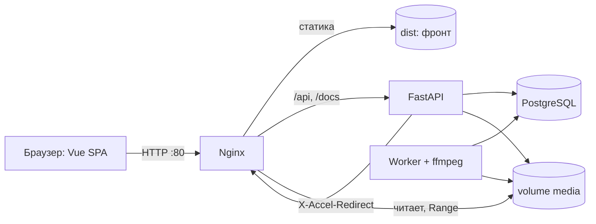
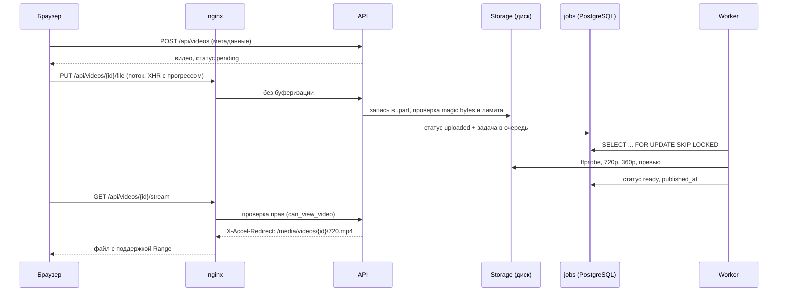

# Архитектура

## Компоненты

Пять сервисов Docker Compose: `postgres`, `api`, `worker`, `nginx` (в dev ещё `frontend-dev`).
Образ `api` и `worker` один и тот же (`backend/Dockerfile`, с ffmpeg), команды разные.
Том `media` монтируется в `api` и `worker` на запись, в `nginx` только на чтение.
Наружу публикуется только nginx.

## Слои бэкенда

`routers → services → repositories → models`, рядом `core/` (конфиг, безопасность, зависимости,
исключения) и `policies/` (чистые функции прав).

- **Роутеры** тонкие: разбор запроса, вызов сервиса, схема ответа.
- **Сервисы** содержат бизнес-логику и управляют транзакциями (`commit` в сервисе).
- **Репозитории** только SQL.
- **Политики** единственное место проверки прав: `can_view_video`, `can_edit_video`,
  `can_view_playlist`, `can_view_comment` и т.д. Они не обращаются к БД: всё нужное сервис передаёт аргументами.
- **Ошибки:** сервисы бросают наследников `AppError`, один обработчик превращает их в HTTP.
- **Конфиг** только из переменных окружения (`core/config.py`).
- **Хранилище** только через интерфейс `Storage` (`DiskStorage` сегодня, S3 завтра).

## Путь видео

Статусы видео: `pending → uploaded → processing → ready | failed`.
Очередь: таблица `jobs` (`status`, `attempts`, `locked_at`, `error`). Воркер обновляет `locked_at`
после каждого шага (heartbeat), раз в минуту возвращает в очередь зависшие задачи и после
`JOB_MAX_ATTEMPTS` попыток помечает видео `failed`. Файл, который не читается как видео,
падает сразу, без повторов. При остановке воркер возвращает текущую задачу в очередь без списания попытки.

Прямых ссылок на файлы нет: `/media/videos/` в nginx помечен `internal`, оригиналы (`originals/`)
не раздаются вообще. Права проверяются на каждый запрос файла, включая превью.

## Аутентификация

- Пароли argon2.
- Access-токен: JWT на 15 минут в httpOnly-куке. Роль и `is_active` читаются из БД на каждом запросе,
  поэтому блокировка и смена роли действуют сразу.
- Refresh-токен: случайная строка, в БД лежит sha256. Ротация при каждом обновлении,
  повторное предъявление использованного токена отзывает всю цепочку (`family_id`).
- Клиент `frontend/src/api/client.js` по 401 один раз обновляет сессию (общий запрос на все параллельные 401)
  и повторяет запрос.

## Видимость и роли

| Видео | Кто видит |
|---|---|
| `public` | все |
| `unlisted` | все, у кого есть ссылка; в ленте и поиске нет |
| `private` | владелец и пользователи из `video_shares` (модератор и админ тоже нет) |
| `hidden_by_moderation` | владелец и модераторы (но не приватное, если доступа нет) |
| канал скрыт владельцем | только владелец |

Роли: пользователь, модератор (скрывает и возвращает видео и комментарии, разбирает жалобы),
администратор (роли, блокировка, правки и удаление чужого). Действия модераторов и админов над чужим
пишутся в `audit_log` в той же транзакции.
Чужое и недоступное всегда отдаёт 404, а не 403, чтобы не раскрывать существование.

## Фронтенд

Vue 3 + Vite + vue-router, без Pinia. Общее состояние (пользователь, тема, сайдбар, подписки, уведомления)
живёт в composables на `ref`/`reactive`. Пользовательский текст выводится только через `{{ }}`.
Стили на чистом CSS с переменными, тёмная и светлая темы переключаются сменой переменных.
Прод: multi-stage сборка в образе nginx. Dev: Vite с прокси `/api` через nginx
(только он обрабатывает `X-Accel-Redirect`).

## Принятые компромиссы

- Очередь на PostgreSQL вместо Redis и Celery: меньше компонентов, достаточно для масштаба проекта.
- Курсорная пагинация по `id`: простая и стабильная, но порядок равен порядку создания, а не публикации.
- Счётчик лайков считается `COUNT`-ом на запрос; при росте нагрузки заменить денормализованным.
- Поиск `ILIKE` с индексом `pg_trgm` без ранжирования.
- Оригинал видео после обработки не удаляется (запас для перекодирования против экономии места).