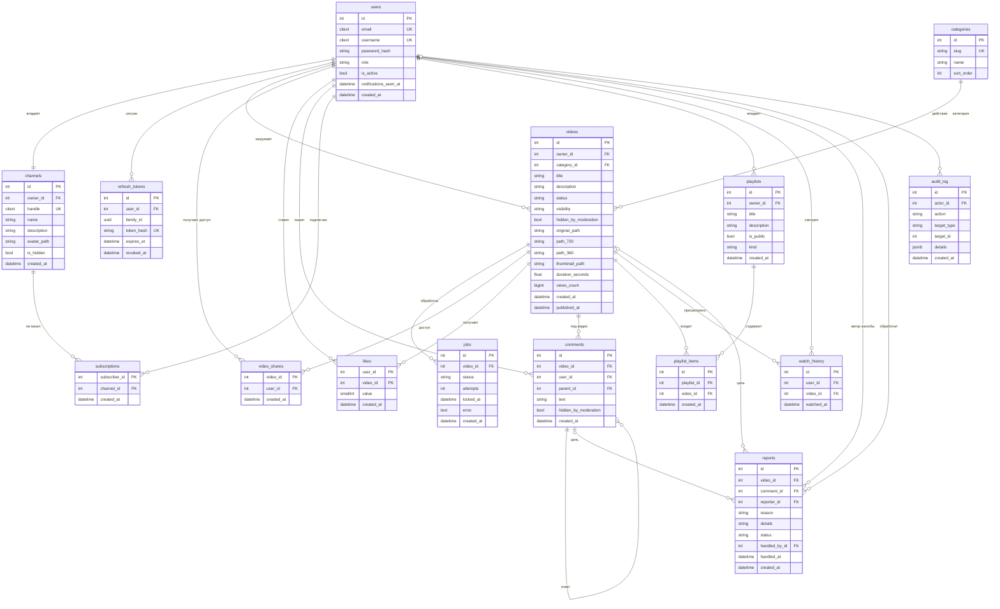

# База данных

PostgreSQL 16, расширения `citext` (регистронезависимые email, username и handle) и `pg_trgm`
(поиск по названию). Схема создаётся миграциями Alembic (`backend/migrations/versions/`).

## ER-диаграмма

## Ограничения целостности

| Таблица | Ограничение |
|---|---|
| `users` | роль `user`/`moderator`/`admin` (CHECK); email и username уникальны без учёта регистра |
| `channels` | один канал на пользователя (`owner_id` уникален); handle уникален без учёта регистра |
| `videos` | CHECK на `status` и `visibility`; FK на `categories` без каскада |
| `jobs` | CHECK на `status` |
| `likes` | CHECK `value IN (1, -1)`; ключ `(user_id, video_id)` |
| `reports` | CHECK `num_nonnulls(video_id, comment_id) = 1` (цель ровно одна); частичные уникальные индексы: одна открытая жалоба пользователя на одну цель |
| `playlists` | CHECK `kind <> 'watch_later' OR is_public IS FALSE`; частичный уникальный индекс: один «Смотреть позже» на пользователя |
| `playlist_items`, `watch_history` | уникальны пары `(playlist_id, video_id)` и `(user_id, video_id)` |
| `audit_log` | `target_id` без FK: запись остаётся после удаления цели, снимок данных лежит в `details` |

Удаление каскадом: пользователь → канал, видео, комментарии, лайки, плейлисты, подписки, сессии, историю;
видео → комментарии, лайки, шеры, задачи, жалобы, элементы плейлистов, историю; комментарий → ответы и жалобы.
Файлы на диске удаляет код после коммита.

## Индексы

Внешние ключи индексированы. Дополнительно: GIN `ix_videos_title_trgm` (`gin_trgm_ops`) для поиска
по подстроке, `ix_jobs_status` для выборки очереди.

## Справочник категорий

`categories` наполняется миграцией, через API не меняется. Список правится в миграции
`backend/migrations/versions/*_categories.py`. Тесты не очищают эту таблицу.

## Очередь

Воркер берёт задачу так: `SELECT ... WHERE status = 'queued' ORDER BY id LIMIT 1 FOR UPDATE SKIP LOCKED`,
сразу переводит её в `running` и коммитит; ffmpeg работает вне транзакции.